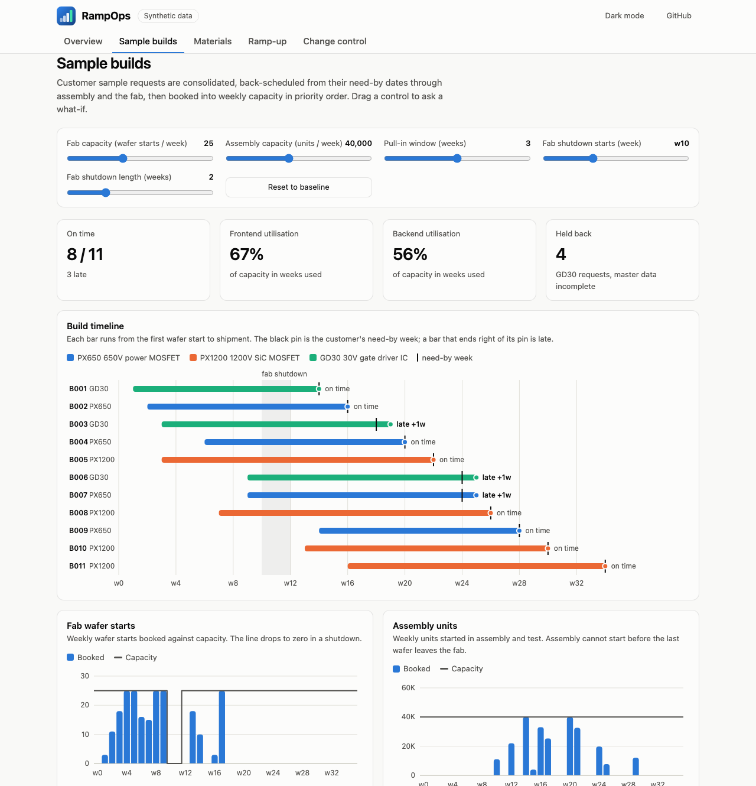
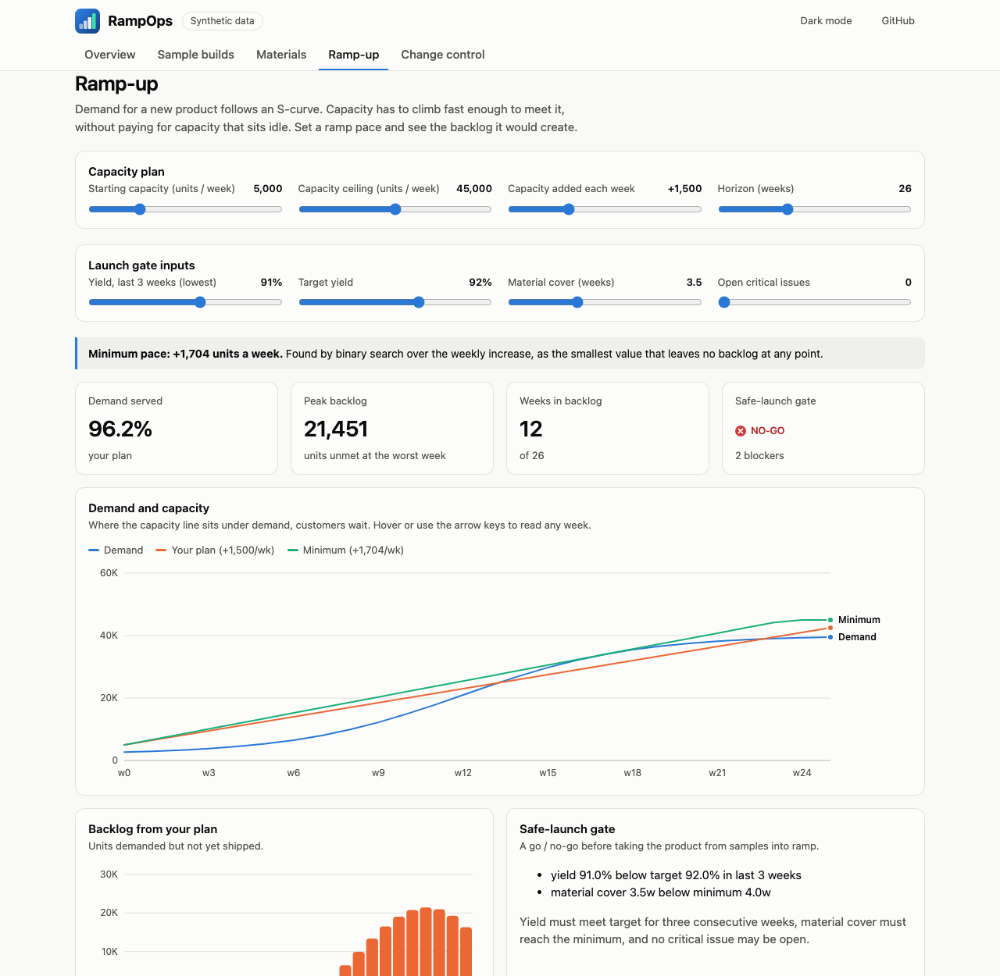
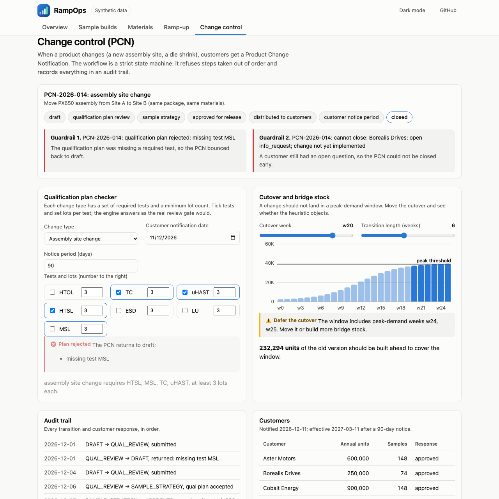
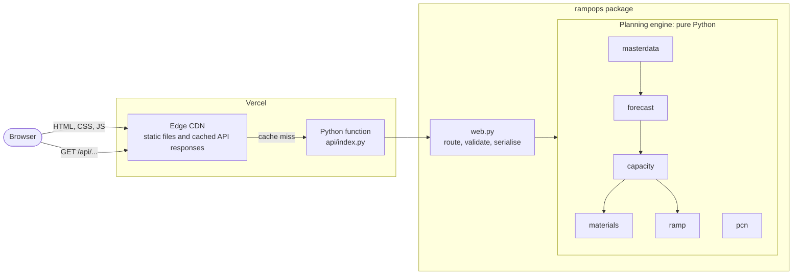
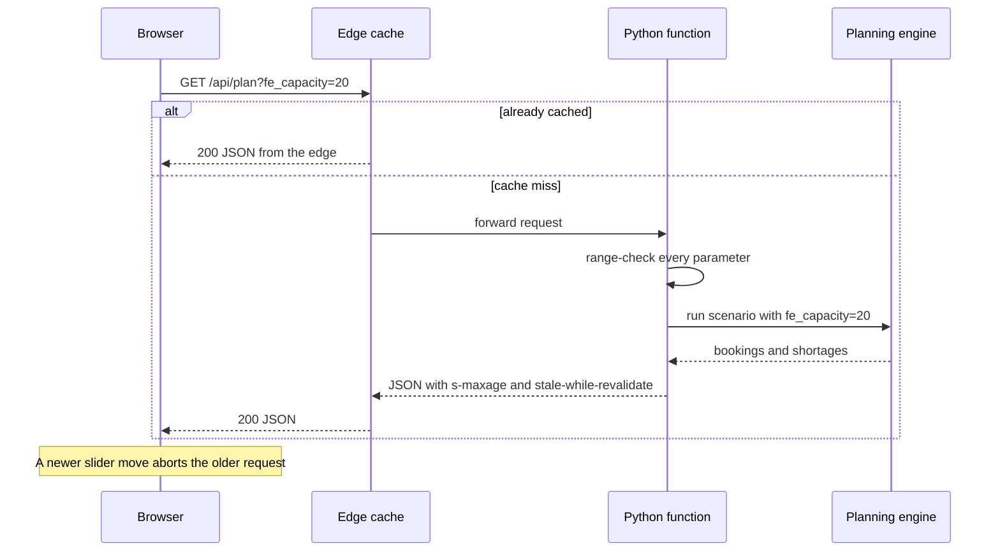
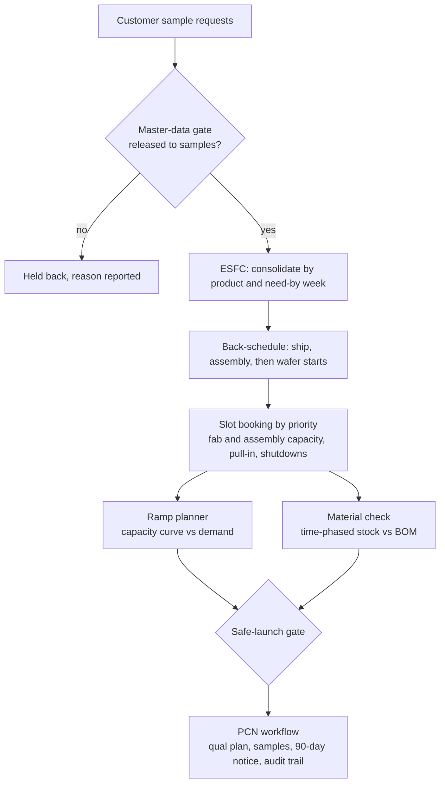
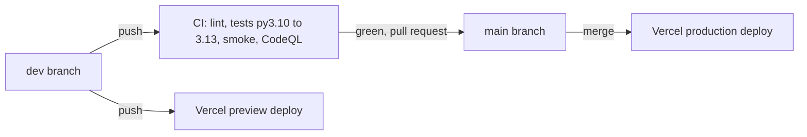

<div align="center">

<picture>
  <source media="(prefers-color-scheme: dark)" srcset="docs/assets/logo-dark.svg">
  
</picture>

**Plan sample builds, ramp capacity to demand, and notify customers of product changes. In one small, fast, dependency-free toolkit.**

**[Live demo: rampops.vercel.app](https://rampops.vercel.app/)**

[](https://github.com/varadarajjborkar/RampOps/actions/workflows/ci.yml)
[](https://github.com/varadarajjborkar/RampOps/actions/workflows/codeql.yml)


</div>

<p align="center"></p>

## What is RampOps?

Before a new chip goes into mass production, a company hands a few thousand **engineering samples** to customers so they can design it in. Those samples have to be built in a factory that is already busy, from materials that take weeks to arrive. Later the product has to **ramp** from a trickle to millions of units, and if anything about it changes, every customer must be **formally notified** with enough notice.

Teams usually juggle this in spreadsheets. RampOps turns it into code you can run, test and question:

- *Can we ship these samples on time, and if not, why not?*
- *Will we run out of any material, and by when must we order it?*
- *How fast must capacity grow so no customer waits?*
- *Is this change notice complete, and is the timing safe?*

It is a learning and portfolio project, **not** an ERP. **All data is synthetic.** Every product, customer, lead time and policy value is invented and configurable.

## What you can do with it

| Area | What it answers | Try it |
|---|---|---|
| **Master data gates** | Which products are allowed to be planned at all? | A product with no approved bill of materials is refused |
| **Sample forecast** | What must be built, and when must wafers start? | Requests merge into build orders, back-scheduled from need-by dates |
| **Capacity booking** | Which orders fit, which slip, and why? | Drag fab capacity down and watch builds go late |
| **Material readiness** | What runs short, and when must we order? | Flags materials whose order-by week has already passed |
| **Ramp-up** | How fast must capacity grow? | Finds the minimum weekly increase that leaves no backlog |
| **Change control (PCN)** | Is this change notice valid and safely timed? | A state machine that rejects steps taken out of order |

<table>
<tr>
<td></td>
<td></td>
</tr>
</table>

## Architecture

The browser talks to one small Python function. That function validates the request, runs the planning engine and returns JSON. The engine has no dependencies and knows nothing about the web.



## System design

### Life of a what-if request

Every answer is a pure function of the query string: same inputs, same plan. That is a deliberate design choice, because it makes every response safe to cache at the edge.



### From request to ramp: how the engine flows



### Delivery pipeline



### Key decisions

| Decision | Why |
|---|---|
| **Standard library only** | Nothing to install, nothing to patch, nothing to supply-chain attack. The function cold-starts fast. |
| **Deterministic planning** | Same inputs give the same plan, so tests are exact and edge caching is safe. |
| **Rules are data** | Required tests, notice days and gate checks live in tables. Change policy by editing a value, not by adding branches. |
| **Fail loudly** | Invalid input or an illegal state change raises an error with a human-readable reason. Nothing is swallowed. |
| **One serverless function** | A single entry point behind a rewrite means one cold start and one thing to secure. |
| **No build step for the UI** | Plain ES modules and hand-drawn SVG: no bundler, no framework, no third-party requests. |

## Tech stack

| Layer | Technology |
|---|---|
| Engine and API | Python 3.10+ standard library (`http.server` handler, dataclasses, enums) |
| Dashboard | Vanilla JavaScript ES modules, hand-built SVG charts, CSS custom properties for light and dark themes |
| Hosting | Vercel: static CDN plus one Python serverless function |
| Quality | pytest (120 tests), ruff, GitHub Actions matrix on Python 3.10 to 3.13, CodeQL, Dependabot |
| Security | Strict Content-Security-Policy, HSTS, bounded inputs, actions pinned to commit SHAs |

## Quick start

```bash
git clone https://github.com/varadarajjborkar/RampOps.git
cd RampOps

python -m rampops serve              # dashboard and API at http://127.0.0.1:8000
python -m rampops demo               # the same scenario as a text report
python -m rampops demo --out report.md

pip install pytest && pytest -q      # 120 tests
```

Needs Python 3.10 or newer. There is nothing else to install.

## API

All endpoints are `GET`, return JSON, and reject out-of-range input with a `400` and a readable reason.

| Endpoint | Purpose | Useful parameters |
|---|---|---|
| `/api/demo` | Plan, ramp and PCN in one round trip | none |
| `/api/plan` | Sample builds, capacity, shortages | `fe_capacity`, `be_capacity`, `max_pull_in`, `maintenance=10,11` |
| `/api/ramp` | Demand vs capacity, minimum pace, launch gate | `start`, `ceiling`, `rate`, `weeks`, `yields`, `cover`, `issues` |
| `/api/pcn` | The demo change notification and audit trail | none |
| `/api/qualcheck` | Is this qualification plan complete? | `change_type`, `tests=TC:3,uHAST:3`, `notify`, `notice_days` |
| `/api/bridge` | Cutover timing and bridge stock | `cutover`, `transition` |
| `/api/report` | The Markdown report | none |
| `/api/health` | Liveness | none |

```bash
curl "http://127.0.0.1:8000/api/qualcheck?change_type=ASSEMBLY_SITE&tests=TC:3,uHAST:3,HTSL:3"
# {"ok":false,"gaps":["missing test MSL"], ...}
```

## Project layout

```text
rampops/            the engine and API (stdlib only)
  models.py           Phase, Product, BomItem, ValidationError
  masterdata.py       phase-gated releases
  forecast.py         sample forecast and back-scheduling
  capacity.py         fab and assembly slot booking
  materials.py        BOM explosion and shortage check
  ramp.py             capacity curve, minimum pace, launch gate
  pcn.py              change-notification state machine
  scenario.py         the synthetic scenario
  web.py, serve.py    JSON API and local dev server
api/index.py        Vercel entry point
public/             the dashboard (HTML, CSS, ES modules)
tests/              120 tests, including API and CSP guards
scripts/smoke.py    smoke-test any running instance
```

## Quality and security

- **Tests:** unit tests for every module, an integration test of the full scenario, real-socket tests of the server, and guards that keep the dashboard compatible with its CSP.
- **CI:** lint, a four-version Python matrix, a smoke test over real HTTP, and one aggregate `ci-ok` check.
- **Security:** a strict CSP with no inline script or style, HSTS, bounded and validated input, a generic error body so internals never leak, and CodeQL scanning. See [SECURITY.md](SECURITY.md).
- **Check a deployment:** `python scripts/smoke.py https://your-deployment --headers` verifies status codes, payloads, latency and security headers.

## Limitations

Honest about scope: single site, single-level bill of materials, integer weeks, no cost or yield learning-curve model, no ERP integration. Policy values (such as the 90-day notice and required qualification tests) are illustrative defaults loosely modelled on common industry practice, not any company's actual process.

## Roadmap

- Multi-level BOM and substitute materials
- Wafer-start smoothing and lot-size rounding
- Last-time-buy and ramp-down scheduling
- CSV and JSON import for requests, inventory and demand

## Contributing

Work happens on `dev`; `main` is production. See [DEVELOPMENT.md](DEVELOPMENT.md) for conventions, commands and the commit style.

## License

[MIT](LICENSE)
